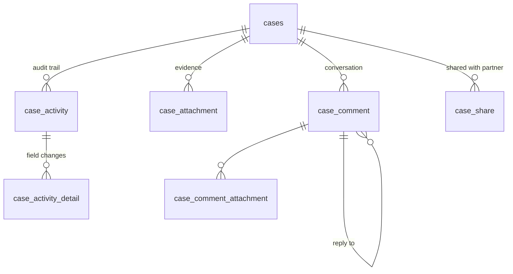

# case-service: database schema (`gc_case`: `ref`, `msg` and 128 shard schemas)

Extracted from the platform schema analysis (growercare `docs/backend/01_RDS_SCHEMA.md`) when the service got its own repository (ADR-017). Keep this file in step with migrations (PR policy R25).

## Roles: Databases, schemas and roles

| Database | Owner service | Schemas | Shape |
|---|---|---|---|
| `gc_iam` | identity-access-service | `iam` | Single schema (low volume: users, grants) |
| `gc_case` | case-service | `ref` + `in_s00…in_s63`, `br_s00…br_s63` | 64 logical shards per country. One schema per shard, built from one migration template |

**Two login roles per database** (`local-dev/postgres/01-init.sh`, mirrored in tests by `PostgresTestDatabase`):

| Role | Used by | Rights |
|---|---|---|
| `<db>_owner` | Flyway only (pre-deploy job in prod, startup locally) | Owns all objects, so it is the only role that can run DDL |
| `<db>_app` | The running service | Reads and writes rows only. It has no DDL rights, can only read `ref.*`, cannot delete or truncate case history, and can only append to `iam.audit_event` |

Tests check these rights explicitly (`LeastPrivilege`, `auditTrailIsAppendOnlyForTheRuntimeRole`). If the service is compromised, it still cannot change the schema or rewrite history.

**A third, cluster-wide role: `gc_cdc`** (SPEC-PLAT-04 D8; `local-dev/postgres/02-cdc-role.sh`, mirrored by `PostgresTestDatabase.CDC_ROLE`). This is Debezium's login. It has `REPLICATION` plus `CONNECT` on both databases. The migrations (placeholder `cdc_role`) grant it:
- `SELECT` on the outbox tables;
- write access to the single-row `cdc_heartbeat` table.

It can read nothing else. `OutboxPublicationIT` / `IamOutboxPublicationIT` check that.

---

## 4. `gc_case` · schema `ref` (replicas and workflow)

```mermaid
erDiagram
  country ||--o{ territory : contains
  country ||--o{ shard : "64 per country"
  country ||--o{ grower : ""
  territory ||--o{ grower : "located in"
  grower ||--o{ farm : owns
  partner_org ||--o{ grower : "preferred by"
  business_unit ||--o{ product : ""
  product ||--o{ product_batch : ""
  product ||--o{ product_registration : "registered in"
  country ||--o{ product_registration : ""
  case_type ||--|{ case_status : defines
  case_status ||--o{ case_transition : from
  case_status ||--o{ case_transition : to
```

**Replicas, with deliberate duplication.** Each service owns its own database (ADR-001), so case-service keeps **read-only copies** of the masters it validates against:
- `country`, `territory`, `business_unit` (owner: control-plane);
- `partner_org` (owner: identity-access);
- `grower`, `farm` (owner: grower-service);
- `product`, `product_batch`, `product_registration` (owner: catalog-registry).

How the copies are handled:
- **Kept to minimal columns,** only what case handling needs. A grower has a name, territory, phone HMAC and preferred retailer, but not the full profile.
- **Keep the same IDs as the owner,** so there's no mapping table.
- **Synced from the owner's events later;** seeded for now.
- **Read-only for the runtime role.**

This is duplication *across* services, which is the accepted cost of database-per-service. Inside one database every fact is stored once.

**Workflow as data (CASE-1):**
- **`case_type`:** one row per type, holding the default SLA.
- **`case_status`:** has a composite key (type, status). A partial UNIQUE index allows **one initial status per type**. `is_closed` marks the statuses that set `closed_at`, and closed statuses drive the 90-day hot window.
- **`case_transition`:** each row is (type, from, to, `required_permission`). Both ends are FKs to `case_status`, so a transition can't point at a status that doesn't exist.
- **Graph checks in a test:** every status is reachable from the initial one, and every open status has a way forward.
- **Country packs** will later add transition rows (versioned) instead of code.

**Shard map:** `ref.shard(country_code, shard_no, schema_name, cluster_key)`.
- A CHECK ties `schema_name` to `lower(cc)_sNN`.
- `cluster_key` names the physical cluster. There's one cluster locally; a map lookup handles the scale-out in `05_SCALING_10M_TO_1B.md`.

**Shared functions:**
- `damm_check_digit(text)` and `id_floor(timestamptz)`;
- Java has twins (`Damm`, `IdCodec.floor`), and tests check that both give identical results.

---

## 5. `gc_case` · per-shard schema (template `db/case/shard`, × 128)



| Table | Key | Partitioned | Notes |
|---|---|---|---|
| `cases` | `case_id` (`next_id()`) | weekly on `case_id` | `case_no` is filled by `next_case_no()`. CHECKs: format, country slot, shard digits, country = shard country |
| `case_activity` | (`case_id`, `activity_id`) | yes | Type-dependent CHECK: `CREATED` has only `to_status`; `STATUS_CHANGED` has both statuses and they differ; other types have none |
| `case_activity_detail` | (`case_id`, `activity_id`, `field_name`) | yes | Old/new values as rows (no JSON diff) |
| `case_attachment` | (`case_id`, `attachment_id`) | yes | Metadata only (S3 key, sha256, size cap, scan status, optional geotag) |
| `case_comment` | (`case_id`, `comment_id`) | yes | UNIQUE (`case_id`, `client_msg_id`) gives idempotent posting. The self-FK for replies is limited to the same case. Comments are soft-deleted |
| `case_comment_attachment` | (`case_id`, `comment_id`, `attachment_no`) | yes | At most 10 per comment, 25 MB each |
| `case_share` | (`case_id`, `partner_org_id`) | yes | ACC-11/12: grower consent time; revoked rather than deleted |
| `case_idempotency` | `client_request_id` | no | CASE-8: request hash catches a reused key with a different body. 7-day TTL |
| `outbox` | `event_id` | no | Read by the Debezium outbox router |

**Composite FKs that enforce cross-table rules** (all checked by tests):

| FK | Rule |
|---|---|
| `(case_type_code, status_code)` → `ref.case_status` | The status exists *for that type* |
| `(grower_id, country_code)` → `ref.grower` | The grower belongs to the shard's country |
| `(territory_id, country_code)` → `ref.territory` | The territory belongs to the shard's country |
| `(farm_id, grower_id)` → `ref.farm` | The farm belongs to that grower |
| `(raised_via_partner_org_id, country_code)` → `ref.partner_org` | The partner operates in that country |
| `(product_id, batch_no)` → `ref.product_batch` | The batch is a real batch of that product |

**References to users have no FKs** (`raised_by_user_id`, `assignee_user_id`, `author_user_id`). Users live in `gc_iam` and a database can't hold a foreign key into another database. The service checks them when writing.

### Deliberate denormalisations (each justified)
| Column | Normal form says | Why we keep it |
|---|---|---|
| `cases.country_code` | Derivable from the schema / `case_id` bits | Lets the composite FKs above check country membership, makes CDC rows self-describing for Snowflake, and lets ABAC filter without decoding. Fixed per shard by a CHECK, so it can't drift |
| `cases.territory_id`, `bu_code` | `territory_id` is derivable from grower → territory | A case keeps the territory **at the time it was raised**. If the grower moves, routing and access for old cases stay stable. This is a historical fact, not a copy |
| `cases.closed_at` | Derivable from activity history | Hot-window routing (90 days after closure) and partition purge need it indexed on the row |
| `case_id` as partition key on child tables | Child rows could be keyed by their own ID only | A case and all its children sit in the same weekly partition, so a week can be verified and dropped as one unit (ADR-004) |

### Indexes and their access paths
| Index | Serves |
|---|---|
| `cases_case_no_ix` | Lookup by public number (IVR/phone, CASE-10). Non-unique, because a partitioned table can't have UNIQUE without the key; `case_no` is unique by construction |
| `cases_grower_ix (grower_id, case_id DESC)` | "My cases", keyset pagination |
| `cases_territory_ix`, `cases_status_ix` | Staff queues within the grant scope |
| `cases_assignee_open_ix … WHERE closed_at IS NULL` | Agronomist worklist (partial index: open cases only) |
| `cases_partner_ix`, `case_share_active_partner_ix` | Partner isolation queries (ACC-11) |
| `cases_batch_ix` | Batch signals (CASE-9); search by product + batch (SPEC-CASE-07) |
| `cases_closed_ix` | Archive routing / purge eligibility |
| PK `(case_id, comment_id)` | Comment feed by keyset (newest first) |

### Partitions
- **Bounds:**
  - One partition per ISO week (Monday 00:00 UTC) for all 7 case-keyed tables.
  - Bounds are `[id_floor(week), id_floor(week + 7d))`.
  - Created by `ensure_week_partitions(back, ahead)`. That function is `SECURITY DEFINER`, so a daily job running as the app role can extend partitions without DDL rights.
  - Migration creates the previous week plus the next 8.
- **Unique violations on partitioned tables name the partition's index,** e.g. `case_comment_w20261109_case_id_client_msg_id_key`, not the parent constraint. Idempotent writes therefore use `ON CONFLICT … DO NOTHING` rather than catching the error (`java-persistence-sql §6`).
- **`*_default` partitions are a safety net and must stay empty.** A non-empty default partition blocks creating the matching weekly partition. That needs an alert, planned with increment 3's scheduled job.

### Migration concurrency
- **Problem:** all 128 shard schemas lock the same shared `ref` tables while migrating (FK and partition DDL). Run in parallel, they deadlocked (SQLState 40P01).
- **Fix:**
  - each shard migration's first statement is `SELECT pg_advisory_xact_lock(7240001)`, which runs shard DDL one at a time, held until commit;
  - `ShardedFlywayMigrator` also retries on deadlock as a safety net;
  - `ShardMigrationConventionsTest` fails the build if a shard migration omits the lock or hard-codes a schema name.

---

## 5a. SLA and routing (SPEC-CASE-04, migrations common V4 / shard V4)
| Table / column | Key | Notes |
|---|---|---|
| `ref.case_sla_policy` | (`country_code`, `case_type_code`) | SLA hours per country × type; absent row ⇒ `case_type.default_sla_hours`. Adverse-incident values are illustrative (validate per country) |
| `ref.case_queue` | `queue_code` (alt: `queue_code, country_code`) | Team inboxes. A CHECK keeps the code prefix equal to the country |
| `ref.routing_rule` | `rule_id` (alt: `country_code, priority`) | Null columns are wildcards. A composite FK keeps queue and territory inside the rule's country. The lowest priority number wins |
| `<shard>.cases.queue_code` | FK (`queue_code`, `country_code`) → `ref.case_queue` | Set at creation by routing; index `(queue_code, case_id DESC)` |
| `<shard>.cases.sla_started_at` | — | SLA window start: creation, or the latest reopen. NULL on pre-V4 rows ⇒ `created_at` |
| `<shard>.case_timer` | (`case_id`, `timer_id`) | Partitioned by `case_id`. `kind` ∈ WARN_50/75/90, BREACH. `fired_at` and `cancelled_at` are mutually exclusive (CHECK). Partial index on `due_at` of pending timers drives the `SKIP LOCKED` poller |

SLA state is **not stored** (it would drift). It is computed from `sla_started_at`, `sla_due_at` and `closed_at`, identically in Java (`SlaRules.state`) and in the list SQL.

## 5b. Event publishing and inbox (SPEC-PLAT-04, migrations IAM V5 / case common V5 / shard V5)
| Object | Key | Notes |
|---|---|---|
| publication `gc_outbox` (gc_iam) | — | `iam.outbox` + `iam.cdc_heartbeat`, `publish = 'insert, update'` (housekeeping deletes are never streamed) |
| publication `gc_outbox` (gc_case) | — | `msg.cdc_heartbeat` + every shard's `outbox`, which shard V5 adds with `ALTER PUBLICATION … ADD TABLE`. Debezium runs with `publication.autocreate.mode=disabled`, so the publication can never become `FOR ALL TABLES` (PII) |
| `iam.cdc_heartbeat`, `msg.cdc_heartbeat` | `id` (= 1, CHECK) | Upserted by Debezium every 10 s (`heartbeat.action.query`). The replication slot advances even without events, so idle outbox traffic never retains WAL. The app role has no rights on it |
| `msg.inbox` | (`consumer_group`, `event_id`) | Idempotent consumers: the row is written in the side effect's transaction and a duplicate is skipped. Index on `processed_at`; 7-day retention job |
| `<shard>.outbox` retention | — | Daily job deletes rows older than 3 days. Debezium has already streamed them from the WAL |

## 5c. Attachments (SPEC-CASE-05, migrations common V6 / shard V6 / IAM V6)
| Object | Key | Notes |
|---|---|---|
| `ref.attachment_type_rule` | (`kind`, `content_type`) | D7 allow-list with `max_bytes` (25 MB images/documents, 100 MB MP4). Reference data, so a country profile can narrow it later |
| `<shard>.case_attachment.scan_status` | — | `AWAITING_UPLOAD → PENDING → CLEAN \| INFECTED \| REJECTED`, `AWAITING_UPLOAD → EXPIRED`. Partial index on (`scan_status`, `created_at`) for unfinished rows drives the scan poller (`SKIP LOCKED`) and the 24 h expiry job |
| `<shard>.case_attachment.comment_id` | FK (`case_id`, `comment_id`) → `case_comment` | D9: a comment attachment is a case attachment linked to one comment, and inherits the comment's visibility. `case_comment_attachment` (V2) is **deprecated** (dropped in a later contract step) |
| `<shard>.case_attachment.scan_attempts` (shard V7) | — | R114: failed scan attempts; each attachment is scanned in its own transaction, and at 3 failures it is REJECTED so a poison file cannot block the shard's queue |
| `object_key` | — | `<shard>/<caseId>/<attachmentId>`: ids only, never file names (PRV-5). Buckets (staging, clean, quarantine) are configuration |
| `latitude` / `longitude` | — | Stay NULL in v1: precise location is PII (PRV-5) and needs field-level encryption first. EXIF GPS is stripped from images |
| `iam.permission` `case:attach` | — | Granted to every role with `comment:post-public` or `comment:post-partner` (9 roles) |

## 5d. Grower replica (SPEC-CASE-06, migrations common V7 / dev-seed V1002)
- `ref.grower` is maintained from grower-service: `grower.*` events trigger a fetch of its internal view, and case creation reads through on a miss, but only after the caller is authorised for that grower (D9). The upsert is version-guarded (`version`, D3).
- The runtime role may `INSERT`/`UPDATE` `ref.grower`, and only that table (`DELETE` revoked). Every other `ref` table stays read-only.
- The status CHECK includes `PENDING_CONSENT`. Only `ACTIVE` growers get cases (D4).
- Foreign-key violations (unknown territory or partner, SQLState 23503) are transient reference-data gaps (D7). Other integrity conflicts, such as a user already linked to another replica grower, are permanent (409 / DLQ at once, D10).
- **Dev seed V1002 was corrected after release (deliberate).** The first version, merged in #6, moved farms 80001–80004 to G1–G4. On any database with cases on those farms, that move violates `cases_farm_fk`, so the migration failed and was never recorded. The corrected version gives G1–G4 new farms (80011–80014) instead.
  - A new `V1003` could not have fixed this: the failing `V1002` runs first.
  - Dev seeds never run in production, and test databases are recreated on every run.
  - The only databases affected are fresh dev databases created from `main`'s image in the short window between #6 and the fix. Those recreate the local `gc_case` volume (checksum mismatch on start).

## 6. Ready for Snowflake
- **Every row carries what the warehouse needs:** `country_code`, `case_id` (time-ordered, decodable), `created_at`/`updated_at`, `version`. Debezium CDC rows are therefore self-describing (doc 03).
- **Facts aren't hidden in JSON,** so Snowflake RAW → CURATED needs no JSON parsing for business fields.
- **The read side goes through ports** (`CaseQueryPort` / `ArchiveCaseQueryPort`, increment 3). Adding the Snowflake adapter adds named SQL under `sql/snowflake/` without touching use cases.

## 7. Known limits and follow-ups
| Item | Plan |
|---|---|
| Replicas of geography and partners are seeded, not yet synced | Event consumers once control-plane and IAM partner events exist. `ref.grower` is synced since SPEC-CASE-06; `ref.farm`, `ref.product`, `ref.product_registration` and `ref.product_batch` since SPEC-CASE-08 (events + read-through, version-guarded; batches only on demand) |
| `case_no` uniqueness is not DB-enforced | Monitoring query; wraparound alert at 60% (doc 04) |
| Direct DML on individual partitions bypasses the parent's REVOKE DELETE | The app always addresses parents; a dedicated purge role arrives with the archiver (ADR-004) |
| Seeding the shard map for a new country needs a common migration | Control-plane will own country activation |
